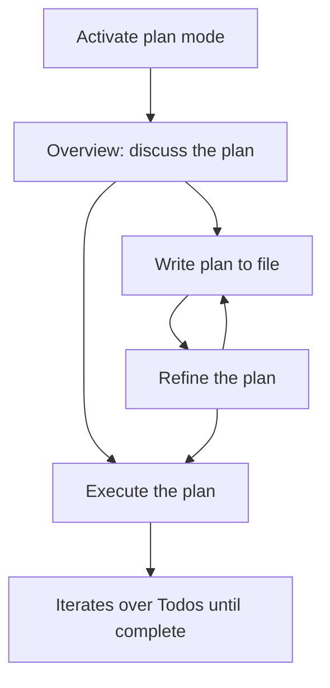

# plan-mode

Discussion-first planning for pi. `/plan` toggles between off and the
overview phase. Overview removes the built-in `write` and `edit` tools from
the active tool set, so the plan lives only in the conversation. Nothing
touches disk until you approve a path.

## Phases

| Phase     | Write/edit tools         | Bash                | Notes                                        |
| --------- | ------------------------ | ------------------- | -------------------------------------------- |
| overview  | Removed from the model   | Read-only guardrail | Discuss, question, propose. No file touched. |
| plan-file | One locked file writable | Read-only guardrail | The approved plan is written to that file.   |
| executing | Full access              | Full access         | Steps tracked with `[DONE:n]` tags.          |

The only way to reach plan-file is through overview. Not every plan needs a
file: from overview you can also execute directly.

## Commands

| Command | What it does                                                   |
| ------- | -------------------------------------------------------------- |
| `/plan` | Toggle plan mode. Turning on always enters the overview phase. |

The shortcut `Ctrl+Alt+P` toggles the mode. The `--plan` flag starts a
session in overview.

## Workflow

1. Run `/plan`. The session enters overview. Write and edit tools vanish
   from the model. Bash passes a read-only guardrail.
2. The agent asks questions, reads code, presents options, and ends with the
   plan as the final section of its response — in the conversation only.
3. At the end of the turn, choose one:
   - `Continue planning` — keep discussing.
   - `Write plan to file` — name the plan file. The extension creates it
     blank on disk, then the agent writes the plan into it.
     Only that file is writable.
   - `Execute plan` — skip the file; full access returns and the plan is
     executed with progress tracking. Only offered once a plan parses and
     no questions are left open.
4. In the plan-file phase the same choice appears, plus `Refine the plan`.
5. The agent marks each finished step with exactly one `[DONE:n]` tag,
   in the same turn that completes the step.

## Step rules

Injected while executing:

- The execution context lists the completed count, the next step, and
  every remaining step, so a forgotten tag shows up as a list that did
  not advance.
- A step is complete only when its signal arrived in that turn: a tool
  result, a command output, or a user message. Background events are not
  signals.
- Exactly one `[DONE:n]` tag per step, in the turn that completes it.
  Never batch tags, never pre-claim, never tag in a later turn — except
  to repair a forgotten tag when the nudge asks.

The nudge: after a turn that used write or edit tools but tagged nothing,
the extension sends a progress check asking whether a step completed.
Repair tags are allowed only there. The nudge never fires twice in a row.

Injected while overview is active:

- Write one action per step. Split steps that end at different times.

When all steps complete, the extension sends an automatic completion
notice. The plan is done. The agent does not respond to that notice; it
waits for the user's next message.

Plan-mode messages never linger in the model's context: display and
trigger artifacts are dropped, and only the newest steering copy stays
while plan mode is active. The transcript keeps every message. The
model's knowledge that the plan is complete comes from its own closing
response, not from plan-mode messages.

Step marks appear live: plan-mode watches the assistant stream and flips
a todo the moment its `[DONE:n]` tag completes, refreshing the widget.
The turn-end pass persists and stays as the backstop.

The todo widget shows a sliding window of up to four pending steps.
Completed ones stay visible until two are done, then the batch drops
and the next pending steps slide in. The full list still reaches the
model through the execution context.

## Paths



Overview can execute the plan directly, or write it to a file first. Once
written, refine the file until it is ready, then execute. The plan is done
when every step completes.

## Plan format

The plan follows the code proposal format, wrapped under a `# Plan` header:

```text
# Plan
## Reasoning
- terse why: approach, key decisions, tradeoffs, assumptions.

## Files
- repo-root-relative paths, one per line, annotated (new), (modify),
  or (delete), each with a terse one-line purpose.

## Implementation
One pseudo-code block per file, headed ### <path>.

## Questions
Only if anything is genuinely ambiguous. Omit when nothing needs asking.
```

- The `# Plan` header is tolerant: any heading level, optional colon,
  optional bold markers. Section headings accept any `#` level too.
- Steps come from the Files section, one per line, labeled
  `path: purpose`. The annotation and purpose text are kept in full.
- The Questions section is numbered so the user can reply by number,
  with a `Proposed solution` under each question. While open questions
  remain, the Execute option stays hidden. After the user answers,
  the model folds the answers into Reasoning and re-emits the full
  plan without the Questions section.
- When the last response has no parseable plan, the agent gets one
  corrective turn that restates the format and the exact problem
  (missing section, no file entries, no path blocks). The execute
  option stays hidden until a plan parses.

## Plan file rules

- The name is asked once when moving to the plan-file phase. It is reused
  while the file still exists on disk. A name collision with an existing
  file forces a new prompt.
- The extension creates the plan file blank and the agent populates it.
  The plan parses from the file, not from the chat message, so Execute
  and Refine appear only when the file holds a valid plan.
- A plan file that still has a Questions section is a format error:
  the agent gets one corrective turn to fold the answers into Reasoning
  and remove the section.
- Only the basename is kept. Directory parts are stripped, so the file
  always lives in the cwd.
- The phase persists across sessions. A session that resumes in plan-file
  while the plan file vanished asks for a new name. A headless session
  falls back to `plan.md`.

## Scope

What is covered:

- The built-in `write` and `edit` tools are removed from the active tool
  set during overview. During plan-file they are gated to one file by
  basename comparison.
- The `bash` tool passes a read-only guardrail during overview and
  plan-file: the command must start with an allowlisted command and must
  not match a destructive pattern (`rm`, `sudo`, redirects, `wget`,
  `find -delete`, and so on). `curl` is allowed for probing local
  services; `wget` stays blocked. Use the `web_search` and `web_fetch`
  tools for web research.

What is not covered:

- Tools registered by other extensions or MCP servers.
- The bash guardrail is best-effort and is not a security boundary. It is
  a pattern list, not a parser.
