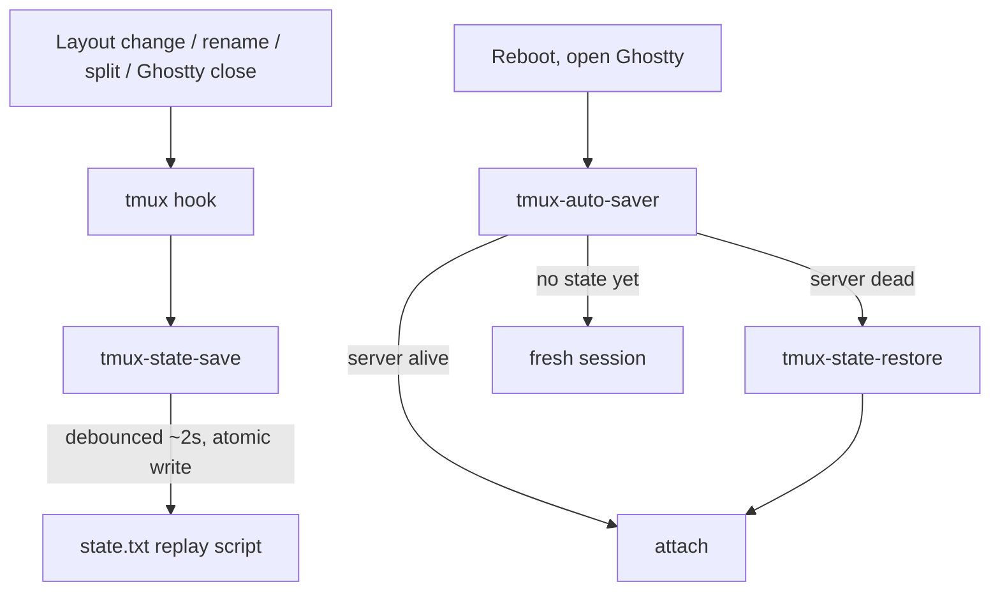

# tmux state save/restore

Native tmux session persistence with zero plugins and zero packages. Your
windows, pane splits, working directories, and allowlisted apps survive a
reboot: close Ghostty, restart the machine, open Ghostty, and you are back
where you were.

Three POSIX `sh` scripts, one generated state file, and tmux hooks.

## Flow



## Files

| file | purpose |
|---|---|
| `tmux-state-save` | snapshots every session into `state/state.txt` |
| `tmux-state-restore` | replays `state/state.txt` on a dead server |
| `tmux-auto-saver` | Ghostty entry point: attach, or restore then attach |
| `state/` | runtime state (gitignored, machine-specific) |

Scripts are symlinked into `~/.local/bin/` by `install.sh`. Each script
resolves its own symlink chain to find the repo, so there are no hardcoded
paths beyond `$HOME`.

## What gets restored

- sessions, windows (names and original indexes), panes
- exact geometry via `select-layout` (layout string round-trip)
- per-pane working directory (`respawn-pane -c` for pane 0,
  `split-window -c` for the rest)
- active pane focus and window zoom state
- allowlisted foreground commands re-run with full argv, launched through
  an interactive zsh so they get your shell environment
  (`zsh -ic "CMD; exec zsh -i"` — the pane survives after the app exits)

## Allowlist

Only allowlisted commands get re-run on restore; everything else comes
back as a fresh zsh prompt in the saved cwd. The allowlist lives at the
top of `tmux-state-save` (`ALLOWLIST_*` variables); adding a wrapper is a
one-line change.

Matching is a **prefix match on the full argv**: an entry `cmd` matches
`cmd` and `cmd arg`, but not `somealias cmd`; an entry `wrapper cmd`
matches `wrapper cmd arg`.

## State files (`tmux/state/`)

- `state.txt` — generated replay script. Not data, not a log: a complete
  snapshot of the current session tree, overwritten atomically (temp +
  rename) on every save.
- `state.epoch` — last-save timestamp for the ~2s debounce.
- `restoring` — transient marker written by restore while it replays, so
  hook-fired saves cannot snapshot a half-built session. Holds the restore
  start epoch; `tmux-state-save` ignores it once stale (60s TTL), so a
  restore killed mid-replay cannot suppress saving forever.

## Hooks (`.tmux.conf`)

15 global hooks fire `tmux-state-save`. `client-detached` covers the
pre-reboot moment; the `after-*` set covers geometry and renames;
`after-swap-window` exists only in tmux >= 3.8.

Hook inventories vary by tmux version, and the man page can be newer than
the binary. Before trusting this list on a new machine, run:

```sh
tmux show-hooks -g    # lists every real hook name for the running server
```

## Known limitations

- Pane scrollback text is not restored.
- Non-allowlisted commands are not re-run by design (dev servers, one-off
  builds): fresh prompt, right directory, you re-run them.
- No hooks exist for `swap-pane`, `move-pane`, `break-pane`, `join-pane`,
  or same-session `move-window` (as of tmux 3.8): those changes save on
  the next covered event or Ghostty close.
- A change made inside the 2s debounce window followed by an instant
  reboot can be missed; saves are event-driven, not a timer.
- argv captured via `pgrep`/`ps` is best-effort: commands containing
  double quotes survive the allowlist wrapper only approximately, and a
  pane with several shell children (background jobs) is skipped.

